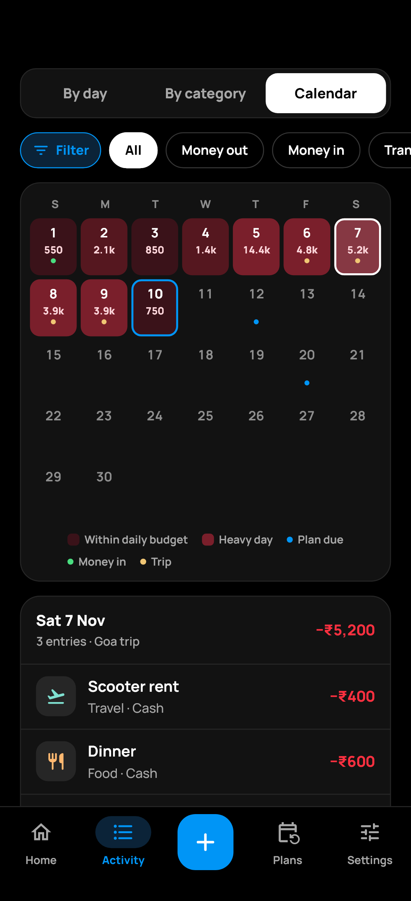
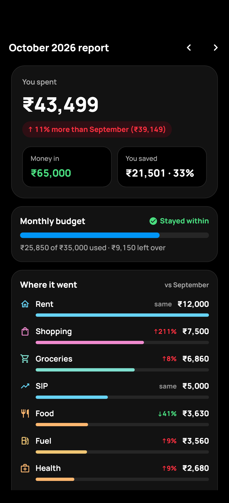
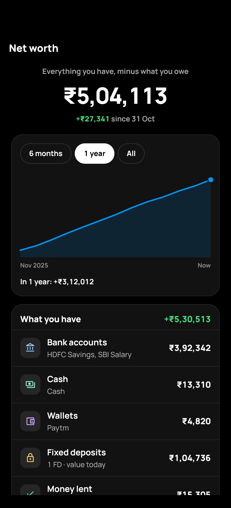
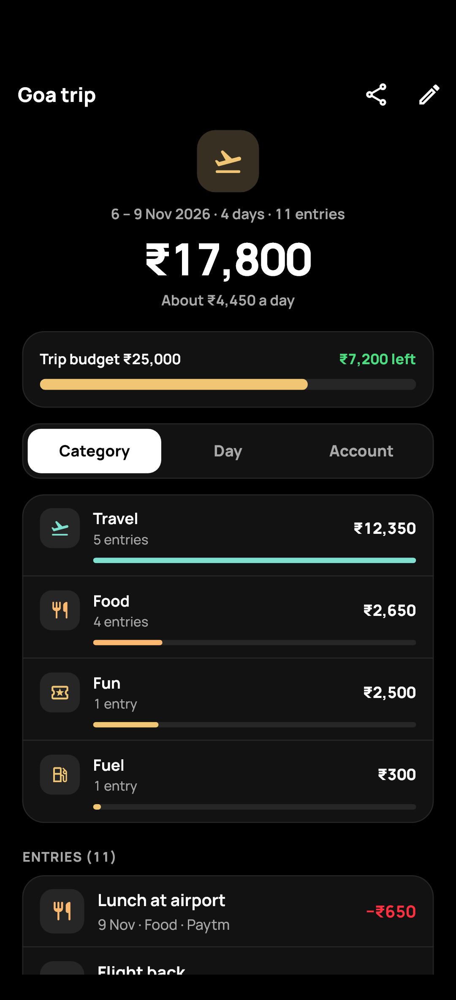

# Funds

**A private, offline money manager for Android, built with Flutter.**
All your data stays on your phone: no account, no cloud, no internet access.

<p align="center">
  
  &nbsp;
  
  &nbsp;
  
</p>

## Features

- **Accounts:** bank (savings / current), cash, wallets and credit cards, each with a passbook showing the balance after every entry. Family or company accounts can be kept out of your own total.
- **Entries:** expense, income and transfer, with categories, notes and dates.
- **Activity:** one month at a time: by day (days fold up), by category, or as a **calendar** that shows what you spent each day and the plans coming up. There's a last-7-days spending chart, filters by account, category and tag, and search across all months.
- **Monthly budget:** one spending limit for the month, plus optional limits per category.
- **Plans:** salary, SIPs, bills & rent and loan EMIs are added to their account automatically on their day.
- **Lend & borrow:** keep track of money you lent to or borrowed from people, with optional simple interest. Payments go to interest first, and you can send WhatsApp reminders.
- **Fixed deposits:** worth today and at maturity (compounded quarterly, monthly, yearly or simple). At maturity you choose to withdraw or renew, with or without the interest.
- **Monthly report:** on the 1st, see how last month went: spent vs the month before, saved, budget, where the money went, a 6-month chart and highlights. Save it as a PDF or an Excel (CSV) file with every entry.
- **Net worth:** everything you have (accounts, FDs, money lent) minus what you owe (card dues, money borrowed), with a graph by month.
- **Tags & trips:** group entries from any account or month, like "Goa trip" or "Office claim", and see the total by category, day or account. A trip has dates and an optional budget; while it's on, new entries get its tag by themselves.
- **Savings goals.**
- **Security:** fingerprint / face / phone PIN lock, and an option to hide amounts.
- **Automatic backup:** every day, week or month into `Downloads/Funds` (kept even if the app is uninstalled), keeping the last 5 copies. Optional password protection (AES-256). You can also share a backup and import it on a new phone.
- **Reminders:** phone notifications for bills, SIPs & EMIs, salary day, credit card dues, lend & borrow due dates, FD maturity, budget at 80% / 100%, the monthly report, and an evening "add today's spending" nudge. All scheduled on the phone; amounts are hidden by default.
- **Feature switches:** turn off anything you don't use. Its data is kept.

## Screenshots

<table>
  <tr>
    <td align="center"><br /><b>Home</b><br />Total balance, money in and out, monthly budget</td>
    <td align="center"><br /><b>Home, further down</b><br />Fixed deposits and what's coming up</td>
    <td align="center"><br /><b>Activity</b><br />Last 7 days chart, days that fold up</td>
  </tr>
  <tr>
    <td align="center"><br /><b>By category</b><br />Where the month's money went</td>
    <td align="center"><br /><b>New entry</b><br />Expense, income or transfer</td>
    <td align="center"><br /><b>Plans</b><br />Salary, SIPs, rent and EMIs added automatically</td>
  </tr>
  <tr>
    <td align="center"><br /><b>Lend &amp; borrow</b><br />Who owes you, and whom you owe</td>
    <td align="center"><br /><b>One person</b><br />Simple interest, payments and reminders</td>
    <td align="center"><br /><b>Fixed deposits</b><br />Worth today, matured FDs first</td>
  </tr>
  <tr>
    <td align="center"><br /><b>One FD</b><br />Progress and amount at maturity</td>
    <td align="center"><br /><b>Accounts</b><br />Banks, cash, cards and family money kept separate</td>
    <td align="center"><br /><b>Settings</b><br />Security, features, backup</td>
  </tr>
  <tr>
    <td align="center"><br /><b>Calendar</b><br />Spending each day, plans coming up</td>
    <td align="center"><br /><b>Monthly report</b><br />How the month went, as PDF or Excel</td>
    <td align="center"><br /><b>Net worth</b><br />What you have minus what you owe</td>
  </tr>
  <tr>
    <td align="center"><br /><b>Tags &amp; trips</b><br />A trip's total by category, day or account</td>
    <td></td>
    <td></td>
  </tr>
</table>

<sub>The screenshots show sample data.</sub>

## Privacy

Funds stores everything in a SQLite database on the phone. It makes no network requests, and Android cloud backup is turned off for the app. Backups are files you control, saved in `Downloads/Funds` or shared by you. Turn on **password protection** so a backup file can't be read without your password. The password is kept only on the phone and is never written into a backup.

## Build and run

Requires Flutter 3.x and the Android SDK.

```bash
flutter pub get
flutter run                                  # phone connected with USB debugging
flutter build apk --release --split-per-abi  # APKs in build/app/outputs/flutter-apk/
```

The release build is signed with the debug key. Before publishing to the Play Store, set up your own signing key: https://docs.flutter.dev/deployment/android#sign-the-app

## Code layout

| Path | What it holds |
|---|---|
| `lib/main.dart` | App start, app lock |
| `lib/theme.dart` | Colours and text styles |
| `lib/data/models.dart` | Account, Entry, Plan, Goal, Budget, Person, Loan, Fd, Tag |
| `lib/data/db.dart` | SQLite tables and upgrades, backup dump/restore |
| `lib/data/recurring.dart` | When plans (salary, SIPs, EMIs) are due |
| `lib/data/lending.dart` | Lend & borrow interest and payment split |
| `lib/data/deposits.dart` | Fixed deposit value and maturity |
| `lib/state/app_state.dart` | All data in memory, balances, net worth, tags, saving, automatic entries |
| `lib/state/report.dart` | Numbers for the monthly report |
| `lib/services/backup_service.dart` | Automatic backup, Downloads/Funds, password protection |
| `lib/services/reminders.dart` | Scheduling reminder notifications |
| `lib/services/report_export.dart` | Monthly report as PDF or Excel (CSV) |
| `lib/screens/` | One file per screen |
| `lib/widgets/` | Shared UI pieces |

Money is stored as whole paise (integers), so totals are always exact.

## License

Funds is released under the Apache License 2.0; see `LICENSE`.

The Manrope font (`assets/fonts/Manrope.ttf`, plus two fixed-weight copies in `assets/fonts/pdf/` for PDF reports) is by The Manrope Project Authors and is licensed under the SIL Open Font License 1.1; see `assets/fonts/OFL.txt`.
